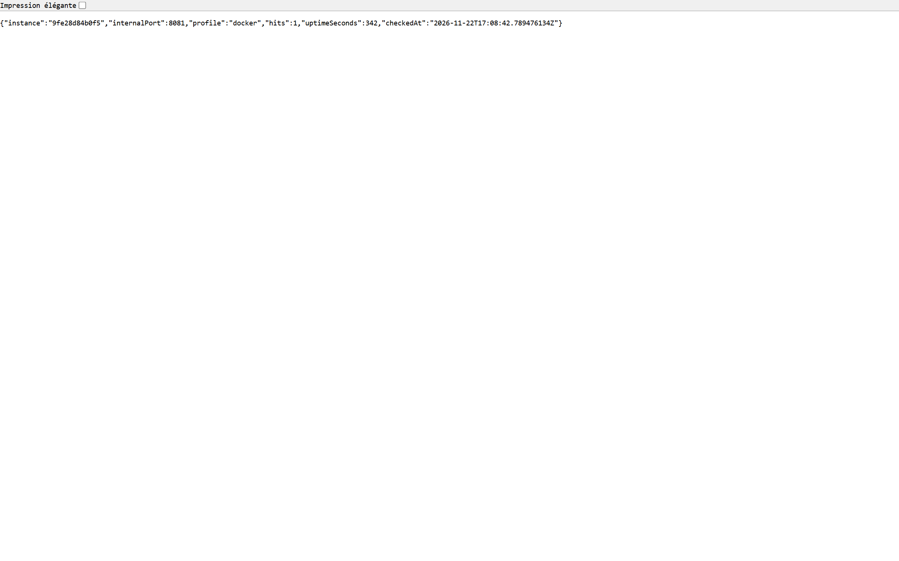
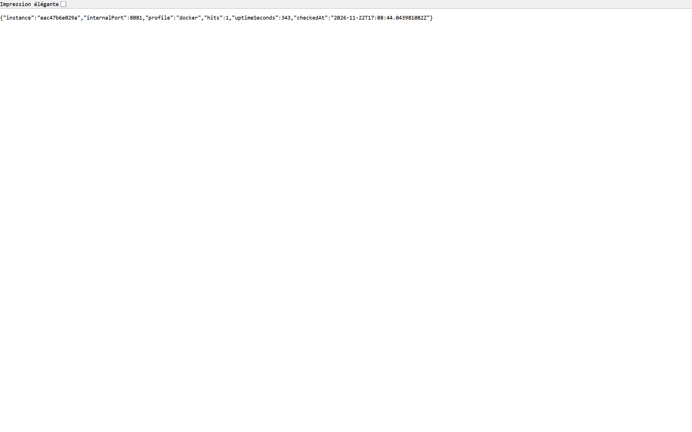
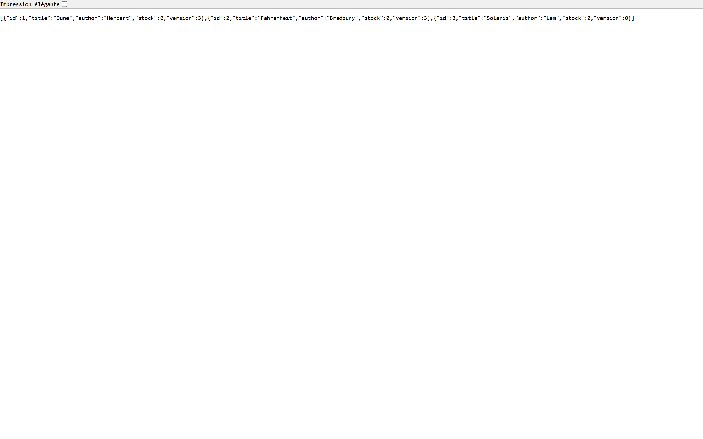
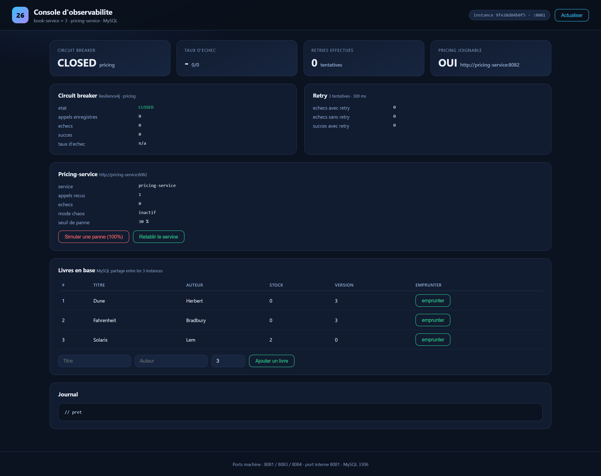
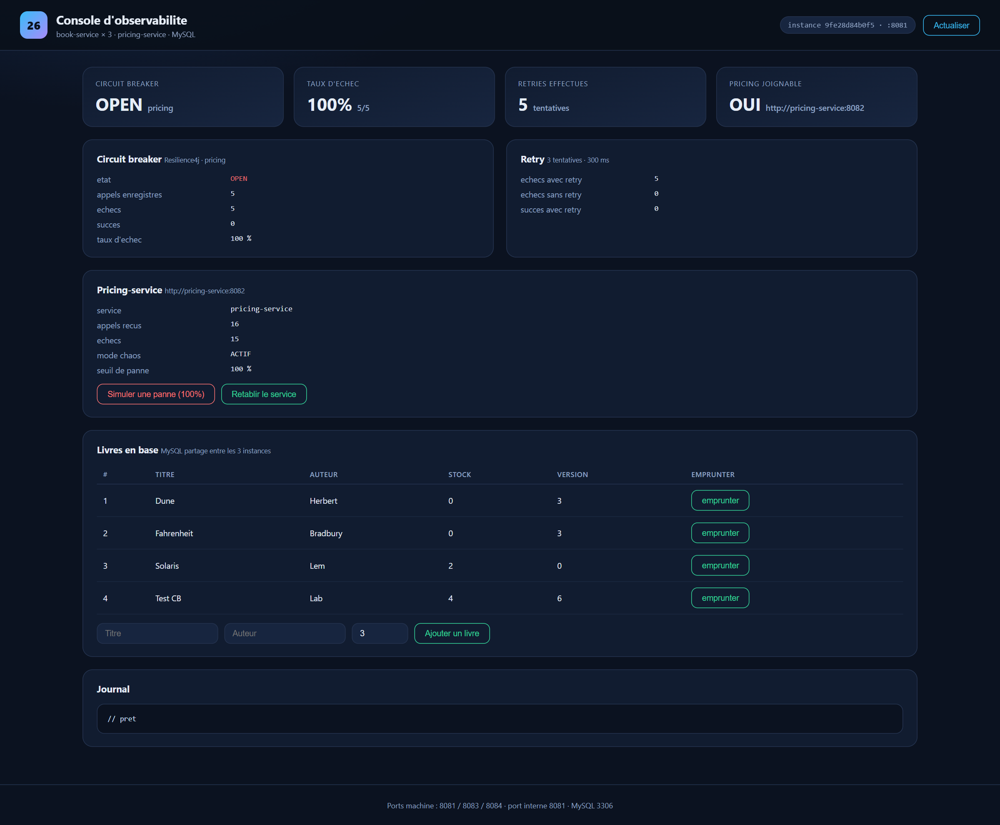

# TP 26 — Microservice observable & resilient
### MySQL + Actuator + Profiles + Wait Strategy + Resilience4j + Multi-instances

---

## 1. pricing-service : observable et panne simulable

  

  

---

## 2. Multi-instances : 3 conteneurs, 3 hostnames

  

  

  

---

## 3. Donnees partagees (meme MySQL)

  

---

## 4. Console d observabilite (fonctionnalite additionnelle)

  

  

